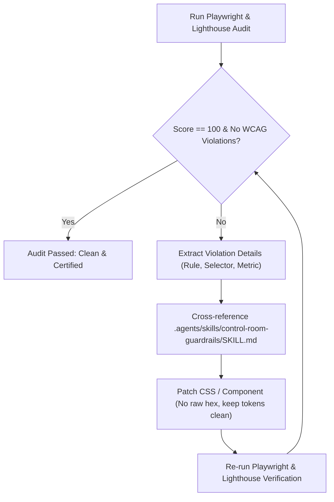

# WCAG & Lighthouse 100/100 Audit Runbook

This skill guides the agent through end-to-end automated accessibility, keyboard navigation, and Core Web Vitals performance audits for the portfolio using Playwright MCP and Chrome DevTools MCP.

The goal is to guarantee **Accessibility = 100** and **Performance = 100** under Google Lighthouse while maintaining strict compliance with WCAG 2.1/2.2 Level AA.

---

## 1. Prerequisites & Environment Check

Before initiating browser testing, ensure the local dev or production server is running.

### Checking or Starting Server (Fish / POSIX compatible)
```fish
# Check if port 3000 is already active
curl -s -o /dev/null -w "%{http_code}\n" http://localhost:3000

# If inactive, start the dev server (or npm run build && npm start for true production metrics)
npm run dev
```

> [!TIP]
> For Lighthouse performance metrics that reflect real-world user metrics (disabling React dev mode overhead), run a production build:
> `npm run build; and npm start`

---

## 2. Multi-Viewport Auditing Strategy

The site has a critical breakpoint at `--breakpoint-wide: 900px`. Audits must be executed at two distinct viewport profiles:

### Viewport Profile A: Desktop Instrument Panel (`1440 x 900`)
- **Desktop Rail**: 264px fixed left rail (`--rail-w: 264px`) displaying identity, live status, and scroll-spy navigation.
- **Main Column**: Stacked readout panels separated by single `1px` borders (`--color-rule`).
- **Canvas Trace**: Active `TraceBackground` canvas running at 30fps with peak opacity 0.11.

### Viewport Profile B: Mobile Folded Rail (`390 x 844`)
- **Mobile Header**: Fixed rail folds into a horizontal top bar below `900px`.
- **Navigation**: Check that nav links wrap or scroll cleanly without overflow.
- **Canvas Trace**: Canvas is suppressed on small viewports (<640px) to conserve mobile GPU resources.

---

## 3. Playwright MCP Testing Procedure

Use the configured `playwright` MCP server to run headless browser evaluations.

### Step 3.1: Navigate and Snapshot Viewports
1. Navigate Playwright to `http://localhost:3000`.
2. Resize viewport to `1440x900`, then capture the accessibility tree snapshot.
3. Resize viewport to `390x844`, verify no horizontal scroll (`scrollWidth === clientWidth`), and capture accessibility tree.

### Step 3.2: Keyboard Navigation & Focus Ring Verification
Simulate sequential `Tab` key presses to traverse the entire DOM:
1. **Focus Order**:
   - First tab stop: Skip-to-content link (if rendered) or the first rail interactive element.
   - Rail elements: Contact links (`github`, `linkedin`, `mail`), section navigation anchors (`#work`, `#experience`, etc.).
   - Panel elements: Project repository links (`.title-link`), external demo links, tech tags with links.
   - Contact form: `Name`, `Email`, `Message` fields, and the `Submit` button.
2. **Focus Indicator Inspection**:
   - Every active element must display the global `:focus-visible` ring:
     ```css
     outline: 2px solid var(--color-signal); /* #1F4B6E */
     outline-offset: 3px;
     ```
   - Ensure focus rings are never clipped by `overflow: hidden` on parent containers.
   - Form inputs (`.field:focus`) must display `border-color: var(--color-signal)` and subtle inner shadow.

### Step 3.3: Accessibility Tree & Landmark Validation
Verify the accessibility tree against WCAG 2.1 AA standards:
- **Landmarks**: Ensure `<header>`/`<nav>` (rail), `<main>` (panels), and `<footer>` are properly designated.
- **Heading Hierarchy**:
  - Exactly one `<h1>` representing the site identity.
  - Section titles are `<h2>` (`#work`, `#experience`, `#stack`, etc.).
  - Project/Role titles are `<h3>`.
  - Zero heading levels skipped (no `<h1>` directly to `<h3>`).
- **Form Labels**:
  - Every `<input>` and `<textarea>` must have an associated `<label>` or explicit `aria-label`.
  - Error messages must be linked via `aria-describedby` or `aria-errormessage`.
- **Interactive Roles & States**:
  - Rail navigation links must set `aria-current="true"` dynamically when their corresponding section is in view.
  - Icons and decorative SVGs must have `aria-hidden="true"`.
  - Functional SVG icons (e.g. external link marks) must carry descriptive labels.

---

## 4. Chrome DevTools MCP Lighthouse Audit

Use the configured `chrome-devtools` MCP server to conduct live DevTools audits.

### Step 4.1: Launch DevTools Session
Connect to the running instance at `http://localhost:3000`.

### Step 4.2: Contrast Ratio Verification (WCAG 1.4.3 & 1.4.11)
Verify computed contrast ratios in the live DOM against background `#F2EFE9`:
- **Body Text (`--color-ink`: `#1D1F24`)**:
  - Ratio on `#F2EFE9`: ~13.9:1 (Exceeds AA 4.5:1 and AAA 7:1).
- **Secondary Text (`--color-muted`: `#5C5B55`)**:
  - Ratio on `#F2EFE9`: 5.9:1 (Exceeds AA 4.5:1).
- **Control Boundaries (`--color-rule-strong`: `#8A877F`)**:
  - Ratio on `#F2EFE9` and `#FBF9F5`: >= 3.0:1 (Meets WCAG 1.4.11 Non-text Contrast).
- **Technology Icon Marks (`icons.generated.ts`)**:
  - Ensure all marks render with their pre-darkened `hex` property (clearing 3:1 against `#F2EFE9`).

### Step 4.3: Core Web Vitals & Performance Audit
Evaluate the following thresholds:
- **LCP (Largest Contentful Paint)**: <= 1.2s. Fonts must use `display: swap` (`Inter` and `Archivo Narrow` via `next/font/google`).
- **CLS (Cumulative Layout Shift)**: `0.00`. Dimension placeholders for dynamic content; no unstyled layout jumps.
- **FID / INP**: <= 50ms.
- **Trace Background Performance**:
  - Ensure canvas loop is throttled to 30fps via `requestAnimationFrame`.
  - Confirm `visibilitychange` listener pauses loop when the browser tab is hidden.
  - Confirm `prefers-reduced-motion: reduce` stops animation loop and renders a static single frame.

---

## 5. Iterative Remediation Workflow

When any audit check yields less than 100 or flags a warning:



### Common Fixes Checklist
1. **Low contrast on button/input edge**:
   - *Never* use `--color-rule` (`#DFD9CE`, 1.3:1) for interactive edges. Switch to `--color-rule-strong` (`#8A877F`).
2. **Missing accessible label**:
   - Check `<Todo />` or empty links. Add `aria-label` or visible text.
3. **Heading sequence failure**:
   - Ensure component headings match semantic hierarchy (`h2` for section header, `h3` for card header).
4. **Performance dip from background animation**:
   - Confirm canvas width/height are set via attributes, not CSS scaling, and check that `prefers-reduced-motion` media query halts the animation loop.
